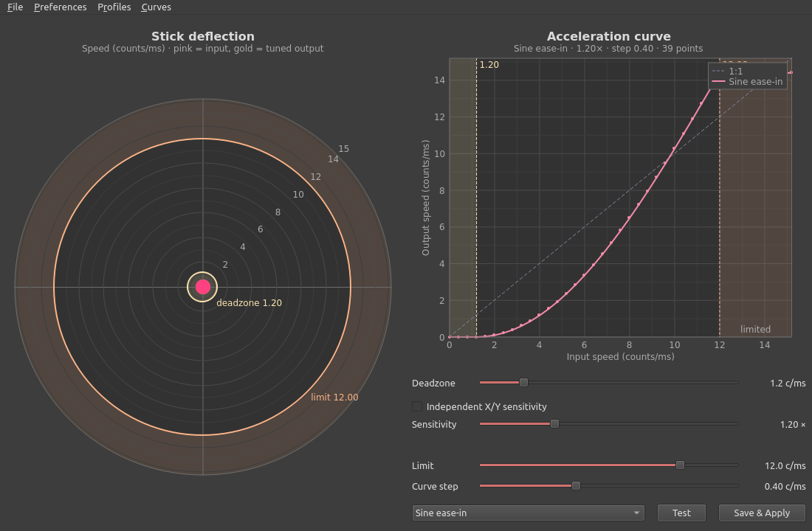

# NippleTuner

Custom acceleration curves for your **TrackPoint** (or any mouse-like pointer) on Linux, with a live preview of what the stick is doing.



Most Linux setups only give a TrackPoint one speed slider and a fixed acceleration profile. NippleTuner lets you shape the whole response: how fine slow, gentle pushes feel, how fast a hard push goes, and everything in between. You get a deadzone, a top-speed limit, and separate X/Y sensitivity, all saved as profiles you can switch from the tray, a hotkey, or the command line.

## Docs

- **[Quick start guide](docs/quick-start.md)**: install, first launch, and tuning your first profile.
- **[Command-line reference](docs/cli.md)**: the `nippletuner` command, with hotkey setup.

## Features

- **Live preview.** A top-down view of the stick shows where you're pushing (pink) and what the tuned output will be (gold). A graph shows the exact curve sent to the pointer, with a marker that follows your push.
- **Curves.** Ten built-in shapes (linear, quadratic, cubic, sine, exponential, logarithmic and more), plus your own: drag points in the curve editor. Custom curves can be renamed, duplicated, imported and exported. The built-in ones are never changed.
- **Shaping.** Deadzone, top-speed limit, shared or independent X/Y sensitivity, and the curve's step size. Deadzone and limit snap to the curve's sample points, so they're exact.
- **Test before saving.** **Test** runs your unsaved settings on the real pointer. **Save & Apply** stores them as a profile and keeps it running.
- **Profiles.** Save, rename, import and export them (custom curves travel with an exported profile). Pick one to load at startup.
- **Lives in the tray.** It can start at login, starts hidden by default, and only one copy runs at a time.
- **Works with the app closed (optional).** A small per-user background service keeps your applied profile running while NippleTuner is closed. Turning it off removes it completely.
- **Command line and hotkeys.** `nippletuner next`, `nippletuner apply Gaming`, `nippletuner toggle`, and more.
- **Fits your desktop.** It uses your system's native Qt look and follows its light or dark theme, or you can force Light/Dark. Theme and device changes apply instantly.
- **Any pointer device.** It picks the TrackPoint automatically, or you can choose a device in Preferences.
- **Sets up its own permissions.** On startup it checks what it needs and walks you through fixing anything missing: it asks for your password once to add you to the `input` group, then reminds you to log out and back in.

## Requirements

- Linux with **X11** (developed on Linux Mint 21 / Cinnamon on a ThinkPad). Wayland hasn't been tested.
- **Node.js 18+** and npm, to build. The CLI and background service also run on Node.
- Access to `/dev/input` and `/dev/uinput`. NippleTuner checks this at startup and offers to fix it (see the [quick start](docs/quick-start.md#1-first-launch-and-permissions)).

## Install

```sh
git clone https://github.com/cadenxbh/NippleTuner.git
cd NippleTuner
npm install
npm run build
npm start -- --show
```

`npm install` downloads the Qt runtime NodeGui needs (a few hundred MB). The [quick start guide](docs/quick-start.md) covers the rest.

## How it works

NippleTuner reads raw movement from the pointer's `/dev/input/event*` device. When a profile is applied, it **grabs** the device (so the desktop stops reading it directly), runs every movement through your curve, and sends the result out through a virtual pointer created with `uinput`. It also turns off the desktop's own acceleration on that virtual pointer, so the two don't stack.

This happens in software because libinput only added custom acceleration curves in version 1.23, and many current distros ship older versions. If NippleTuner stops for any reason, the kernel releases the grab and your pointer goes straight back to normal.

## Undoing everything

- **Pointer back to normal:** tray → **Turn Off**, or `nippletuner off`.
- **Background service:** uncheck Preferences → *Keep Applied Profile Running When Closed*. From a terminal: `systemctl --user disable --now nippletuner.service`.
- **Start at login:** uncheck Preferences → *Load on Startup*. That removes `~/.config/autostart/nippletuner.desktop`.
- **Settings, profiles and curves:** delete `~/.config/NippleTuner/`.

## Development

```sh
npm run build        # TypeScript → build/, then esbuild bundles → dist/
npm start -- --show  # run the app with its window open
```

`npm run build` produces three bundles:

| Bundle | What it is | Runs on |
|---|---|---|
| `dist/main.cjs` | the app | qode (NodeGui's Qt-enabled Node) |
| `dist/daemon.cjs` | the background service | plain Node |
| `dist/cli.cjs` | the `nippletuner` command | plain Node |

```
src/
  main.ts, App.ts   entry point and composition root
  app/              controllers: tuning panel, live view, device control, profiles, curves, preferences, theme, CLI commands, permissions
  widgets/          custom-painted graph, stick preview, slider, curve editor
  windows/          main window, curve editor window, dialogs
  menus/            menu bar and tray
  pointer/          low-level device library: evdev reading, uinput output, curves
  curves/ profiles/ settings/ service/ util/
  daemon.ts, cli.ts background service and CLI entry points
```

## License

MIT. See [LICENSE](LICENSE). The project started from [nodegui-simple-starter](https://github.com/sedwards2009/nodegui-simple-starter).
