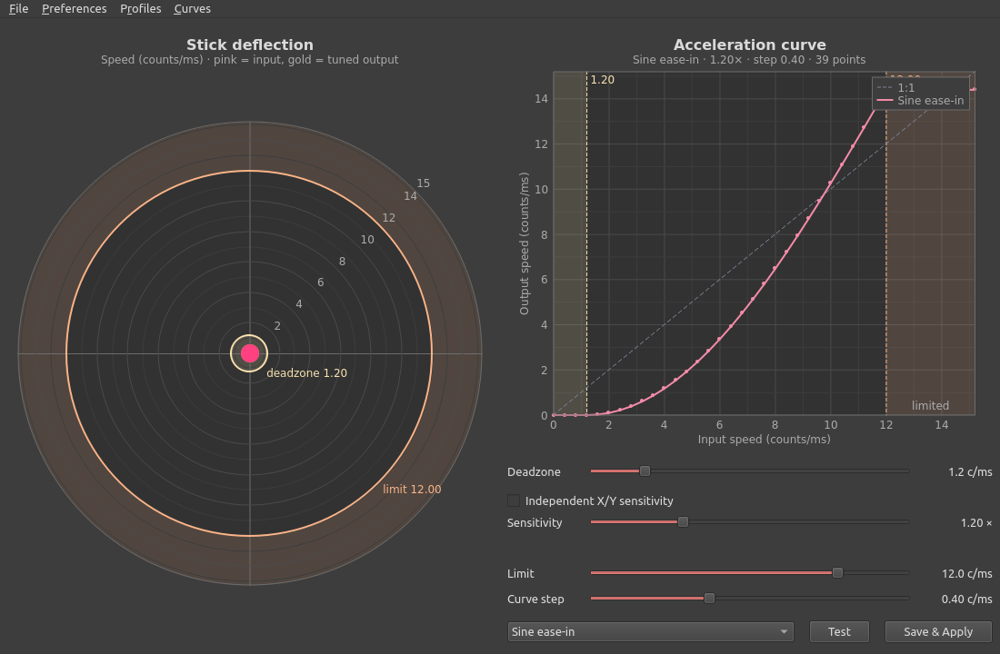

# Quick start

This guide goes from a fresh clone to a tuned TrackPoint profile that starts with your computer. It takes about five minutes.

← [Back to README](../README.md) · [Command-line reference](cli.md)

---

## 0. Build and run

```sh
npm install
npm run build
npm start -- --show
```

NippleTuner lives in the system tray and normally starts hidden. `--show` opens the window straight away. After that, click the tray icon (a pink dot in a ring) to show or hide the window.

## 1. First launch and permissions

To read the TrackPoint and apply curves, NippleTuner needs:

- read access to the pointer device (`/dev/input/event*`), which your account gets by being in the **`input`** group
- write access to `/dev/uinput`, to create the virtual pointer that sends the tuned movement

Every time it starts, NippleTuner checks these again. If something's missing, it explains what and why:

| You see | What to do |
|---|---|
| **"NippleTuner needs permission to access your TrackPoint"** | Click **Grant Access…** and enter your password. **Show Details** lists the exact commands it runs as root (`usermod -aG input <you>`, plus a one-line udev rule if `/dev/uinput` needs it). Nothing else is changed. |
| **"Log out to finish"** | Linux only applies group changes at login. Click **Log Out Now…** (or log out yourself) and log back in. |

You only do this once. You can re-run the check any time from **Preferences → Check Permissions…**.

## 2. A tour of the window



- **Stick deflection (left).** A top-down view of the stick. The **pink** dot is how hard you're pushing. The **gold** dot is what the tuned pointer will do with that push. The rings are speeds, in counts/ms. A yellow ring and area mark the deadzone, and an orange ring and area mark the limit.
- **Acceleration curve (right).** Input speed across, output speed up. The dots are the actual sample points sent to the pointer. The dashed line is 1:1, meaning no change. While you push the stick, a blue marker shows where you are on the curve.
- **Sliders:**
  - **Deadzone:** below this speed the pointer doesn't move. Use it to stop drift.
  - **Sensitivity:** multiplies the output. Tick *Independent X/Y sensitivity* to set horizontal and vertical separately.
  - **Limit:** the speed where the curve tops out. Pushing harder won't go faster than this.
  - **Curve step:** spacing between the curve's sample points. Smaller means more points.
- **Bottom row:** the curve dropdown, **Test** and **Save & Apply**.

By default the graphs pause and grey out while the window isn't focused, to save effort. Click the window to resume, or turn it off in **Preferences → Update Graphs on Focus Only**.

## 3. Tune a profile

1. **Pick a curve** from the dropdown. **Linear** or **Sine ease-in** are good places to start. Shapes that start very flat, like **Cubic** or **Quartic**, barely move the pointer on light pushes.
2. **Click Test.** Your current settings now drive the real pointer. Move it around and adjust the sliders; changes apply instantly. Click **■ Stop Test** to go back. A test also ends when you close the window.
3. **Click Save & Apply** and give the profile a name. NippleTuner saves it and keeps it running, even with the window closed. The window title shows what's applied, for example *"(applied: Gaming)"*.

If something goes wrong and the TrackPoint feels unusable, use the touchpad: click **Stop Test**, or tray → **Turn Off**.

## 4. Make your own curve

**Curves → New Curve…** opens the curve editor:

- **drag** a point to move it
- **double-click** empty space to add a point
- **double-click** or **right-click** a point to remove it
- **Start from** loads the points of any existing curve

The line through your points never overshoots, so points that keep rising give a curve that keeps rising. Click **Save**, and the curve appears under the built-in ones in the dropdown and the Curves menu.

Built-in curves can't be changed. **Edit** on one makes an editable copy instead.

## 5. Start with your computer

In **Preferences**:

- **Load on Startup:** starts NippleTuner (in the tray) when you log in.
- **Startup Profile ▸:** the profile to apply automatically when it starts.
- **Show GUI on Startup:** open the window as well. It's off by default, so the app starts quietly in the tray.

## 6. Optional extras

- **Keep Applied Profile Running When Closed** (Preferences): installs a small per-user background service. It keeps your applied profile working when NippleTuner isn't running, including right after login. While the window is open, the app is in charge and the service waits. To undo it, uncheck the option, or run `systemctl --user disable --now nippletuner.service`.
- **Device ▸** (Preferences): if the wrong device was picked automatically, choose the right one here. The switch happens immediately and is remembered.
- **Theme ▸** (Preferences): Match System, Light or Dark. Applies instantly.
- **Profiles menu:** switch between saved profiles, rename them, or delete them. **File → Import/Export Profile** shares a profile as a file; a custom curve is included.
- **Hotkeys and scripts:** see the [command-line reference](cli.md). For example, bind `nippletuner next` to a key to cycle profiles.

## Troubleshooting

| Problem | Fix |
|---|---|
| "Another program is controlling the TrackPoint" | Something else has exclusive control of the device, such as a remapping tool with a TrackPoint preset (for example input-remapper). Close or reconfigure it. Only one copy of NippleTuner runs at a time, so a second launch just shows the existing window. |
| The pointer feels "doubled" (too fast) | The desktop re-enabled its own acceleration on NippleTuner's virtual pointer. NippleTuner turns it off again within a few seconds. If it keeps happening, set the desktop's mouse acceleration to *flat*. |
| Nothing happens when pushing | Check **Preferences → Check Permissions…** and **Preferences → Device**. |
| Hotkeys don't work while the app is closed | Turn on *Keep Applied Profile Running When Closed*, or keep NippleTuner running in the tray. |

---

← [Back to README](../README.md) · [Command-line reference](cli.md)
